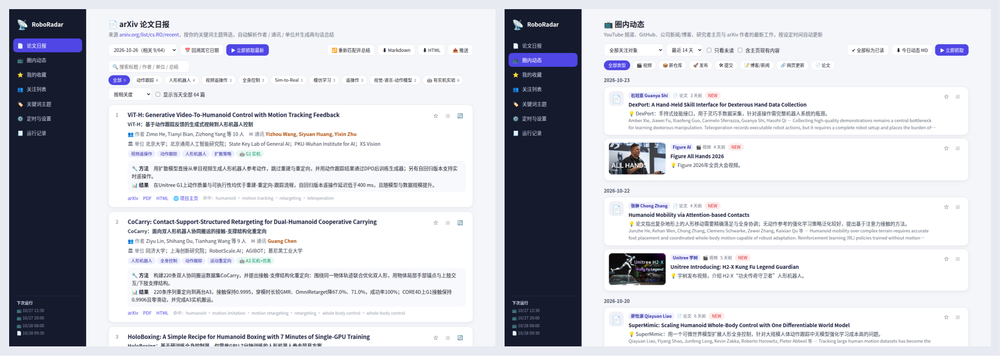

# RoboRadar

**English** | [简体中文](README.zh-CN.md)

RoboRadar is a locally hosted robotics intelligence tool with a web UI. Every day, on a schedule, it filters new arXiv cs.RO papers by your custom keywords and produces a summarized paper digest. It also tracks the latest work and blog posts from top robotics companies and researchers you follow, across YouTube, GitHub, official websites and personal homepages. Results can be exported and pushed as notifications.



> The web UI is currently in Simplified Chinese. UI labels below are given as **English name** (中文标签).

## Installation

### 0. Requirements

| Item | Requirement |
|---|---|
| OS | Linux (tested on Ubuntu 24.04). macOS works, but you need to set up autostart yourself. On Windows it can only be started manually |
| Python | 3.10+ (3.12 recommended) |
| Network | Access to arxiv.org, youtube.com and github.com. If these are blocked, use a system proxy or TUN mode, or set an HTTP proxy in Settings |
| Summarization model (pick one) | ① A locally logged-in Claude Code (`claude` command, default); ② an Anthropic API key; ③ an OpenAI-compatible API key (DeepSeek, Qwen, Kimi, …); ④ no LLM (rule-based extraction only, no summaries) |

### 1. Get the code

```bash
git clone <repo-url> robo-radar     # or simply copy the whole directory
cd robo-radar
```

Run all following commands inside `robo-radar/`.

### 2. Create a Python environment and install dependencies

**Option A: conda (recommended)**

```bash
conda create -n roboradar python=3.12 -y
conda activate roboradar
pip install -r requirements.txt
```

**Option B: venv**

```bash
python3 -m venv .venv
source .venv/bin/activate
pip install -r requirements.txt
```

Check that the install worked:

```bash
python -c "import fastapi, apscheduler, feedparser, pymupdf; print('deps OK')"
```

> `run.sh` and the service installer use `~/miniconda3/envs/roboradar/bin/python` by default. If your Python is elsewhere (e.g. a venv or anaconda3), set this first:
> ```bash
> export ROBORADAR_PYTHON=$(which python)   # run inside the activated environment
> ```

### 3. Set up the summarization model (LLM)

Pick one of the options below. You can switch at any time in the web UI under **Settings → Summarization model** (定时与设置 → 总结模型), and use **Test connection** (测试连接) to check it.

**① Local Claude Code (default, no API key needed)**

Install Claude Code following the [official docs](https://code.claude.com/docs) and log in once. Then confirm the CLI works:

```bash
claude -p "reply OK"        # any output means it works
```

The model can be `sonnet` (default), `opus` or `haiku`.

**② Anthropic API**

Choose **Anthropic API** in Settings and enter your API key, or set the `ANTHROPIC_API_KEY` environment variable before starting. The default model is `claude-opus-5-5`; you can change it.

**③ OpenAI-compatible API (DeepSeek / Qwen / Kimi, …)**

Enter the base URL, model name and key in Settings. For DeepSeek, for example: `https://api.deepseek.com` with model `deepseek-chat`.

**④ No LLM**

Choose **No LLM** (不使用 LLM). Tags come from the matched keyword topics, corresponding authors and affiliations are extracted from the PDF first page with rules, and method and result are taken from abstract sentences.

### 4. First run

```bash
./run.sh            # default port 8770; opens your browser automatically
./run.sh 9000       # use another port
```

Open **http://127.0.0.1:8770**. On first start the program:

- creates `data/settings.json` and the `data/roboradar.db` database, seeded with the default keyword topics and the default watchlist;
- runs the paper digest once if today's arXiv schedule time has already passed, and crawls the watchlist once. A progress bar appears at the top of the page; this takes about 1–2 minutes.

Press `Ctrl+C` to stop the foreground run.

### 5. Initial setup in the web UI

1. **⚙️ Settings** (定时与设置)
   - Set the arXiv digest time (default 09:30). arXiv publishes new announcements at 20:00 US Eastern Time (08:00 / 09:00 Beijing time); schedule the digest after that.
   - Set watchlist crawl times (default 08:00, 12:30, 20:00). You can add several.
   - Choose the LLM backend, then click **🔌 Test connection**.
   - Optional: set up notifications (Feishu, DingTalk, WeCom or Slack webhooks, or SMTP email) and click **📨 Send test notification**.
   - Optional: set an HTTP proxy (e.g. `http://127.0.0.1:7897`) if YouTube or arXiv access is unstable.
   - Optional: add a GitHub token to raise the API limit from 60 to 5000 requests per hour.
   - Click **💾 Save**. The schedule takes effect immediately.
2. **🏷️ Keyword topics** (关键词主题): each topic is a tag name plus a list of English keywords, one per line.
   - **Filter + tag** topics: a match includes the paper in the digest.
   - **Tag only** topics: only used to tag papers.
   - A keyword written as `a + b` requires both terms to appear.
   - Click **Save and re-match the latest day** to see the effect right away.
3. **👥 Watchlist** (关注列表): click **＋ Add**, enter a name and type, then paste one or more URLs. The URL type is detected automatically, and **🔍 Test fetch** previews what will be fetched. Supported formats:

   | Input | What is fetched |
   |---|---|
   | `https://www.youtube.com/@figureai` | Latest channel videos |
   | `https://github.com/qiayuanl` (user or org) | Newly created repositories |
   | `https://github.com/owner/repo` | Releases, or latest commits if there are no releases |
   | `https://openai.com/news/rss.xml` | Any RSS / Atom feed, including RSSHub feeds for Bilibili, X, etc. |
   | News pages, blogs, personal homepages | Looks for an RSS feed on the page first; otherwise detects newly added paper or article links |
   | `arxiv-author:Qiayuan Liao` | New arXiv papers by this author |
   | `arxiv-author:Chong Zhang\|cs.RO` | Same, restricted to cs.RO (useful for common names) |

   For broad companies such as OpenAI or Tesla, add **filter keywords** (e.g. `robot, humanoid, optimus`) to keep only robotics-related updates.

### 6. Install as a background service (autostart, recommended)

Scheduled jobs run inside the program's own scheduler, so **the program must stay running**. On Linux, one command installs it as a systemd user service:

```bash
# If the foreground run from step 4 is still running, stop it with Ctrl+C first to avoid a port conflict
./scripts/install_service.sh          # default port 8770; another port: ./scripts/install_service.sh 9000
```

The script:

- writes `~/.config/systemd/user/roboradar.service` and enables it to start on login;
- adds a **RoboRadar** entry to the application menu that opens the UI in your browser.

Check that the service is running:

```bash
systemctl --user status roboradar      # should show active (running)
curl -s http://127.0.0.1:8770/api/status | head -c 300
```

To keep it **running even when you are not logged in** (e.g. on a server), also run:

```bash
loginctl enable-linger $USER
```

> **Alternatives without systemd**
> - Keep `./run.sh` running in tmux or screen;
> - Or skip the web server and call the CLI from cron. Results are still written to the database and show up the next time you open the UI:
>   ```cron
>   30 9 * * *        cd /path/to/robo-radar && $HOME/miniconda3/envs/roboradar/bin/python -m roboradar arxiv
>   0 8,12,20 * * *   cd /path/to/robo-radar && $HOME/miniconda3/envs/roboradar/bin/python -m roboradar watch
>   ```

### 7. Day-to-day management, updates and uninstall

```bash
journalctl --user -u roboradar -f          # follow logs
systemctl --user restart roboradar         # restart after code changes (for front-end changes under static/, just reload the page)
systemctl --user stop roboradar            # stop temporarily

# Uninstall the service (data is kept)
systemctl --user disable --now roboradar
rm ~/.config/systemd/user/roboradar.service ~/.local/share/applications/roboradar.desktop
systemctl --user daemon-reload
```

Update dependencies: `pip install -r requirements.txt --upgrade`.

---

## Usage

### Pages

| Page | Features |
|---|---|
| 📄 Paper digest (论文日报) | Switch dates; go back to any of the last 5 announcement days; filter by tag or "has real-robot experiments"; search and sort; star, mark as read, re-summarize; with "show all papers of the day" you can add a missed paper in one click (➕); export Markdown / HTML; push manually |
| 📺 Community feed (圈内动态) | Filter by watched entity, type (video / new repo / release / blog / paper / page update) and time range; new items are marked NEW; mark all as read; export today's feed |
| ⭐ Starred (我的收藏) | Starred papers and updates; search all past papers |
| 👥 Watchlist (关注列表) | Manage companies, researchers and labs and their URLs; crawl a single entity; see whether each source's last fetch succeeded |
| 🏷️ Keyword topics (关键词主题) | Manage topics; toggle LLM semantic screening, which lets the LLM pick relevant papers that matched no keyword |
| ⚙️ Settings (定时与设置) | Schedule times, arXiv categories, LLM, notifications, proxy, GitHub token |
| 🧾 Run history (运行记录) | Result of each job, with failed sources and reasons |

### Command line

```bash
python -m roboradar serve [--port 8770] [--open]   # start the web UI and the scheduler
python -m roboradar arxiv                          # build the digest for the latest announcement day now
python -m roboradar arxiv --date 2026-10-23        # a specific announcement day (the recent page keeps the last 5)
python -m roboradar arxiv --force                  # re-match with current keywords and re-summarize
python -m roboradar watch                          # crawl the watchlist once now
```

### How it works

- **Paper digest**:
  1. Get the latest announcement day's paper list from the recent page (falls back to RSS on failure);
  2. Fetch titles, abstracts, authors and comments in batch via the arXiv API;
  3. Match against your keywords;
  4. Optionally run LLM semantic screening;
  5. For relevant papers, download the PDF first page (or the HTML version if the PDF is too large) and parse authors, affiliations and corresponding-author markers;
  6. The LLM produces a Chinese title, tags, experimental platform, corresponding authors, affiliations, method and result;
  7. Save to the database, write reports and push notifications.
- **Community feed**: fetch each enabled source and store new items (only those published in the last N days; N is configurable). Then make a single LLM request that writes a one-sentence summary for every new item.
- **Catch-up**: on startup, if today's arXiv time has passed without a successful run, the digest runs once. The watchlist is also crawled if it hasn't been in 6 hours. Scheduled jobs only send notifications when there is new content, so old digests are not re-sent on weekends.

### Data

All data lives under `data/` (override with the `ROBORADAR_DATA` environment variable). To back up, copy the whole `data/` directory.

| File | Contents |
|---|---|
| `data/settings.json` | All settings and keyword topics |
| `data/roboradar.db` | SQLite database: papers, watched entities, feed items, run history |
| `data/reports/arxiv-YYYY-MM-DD.{md,html}` | Daily paper reports |
| `data/reports/watch-YYYY-MM-DD.md` | Daily feed reports |

---

## FAQ

**The page says no papers were found for the announcement day?**
arXiv does not announce new papers on weekends and holidays, so this is expected. Use **📅 Go back to another date** to view earlier days.

**Paper cards show "rule-based" (规则提取) or "LLM failed" (LLM 失败)?**
The LLM is not working. Click **Test connection** in Settings to see the error. With the Claude Code backend running as a service, make sure `claude` is in `~/.local/bin`, `/usr/local/bin` or `/usr/bin`. The service's PATH only includes these directories; you can change it in `install_service.sh`. Once fixed, click 🔄 on a card to re-summarize that paper.

**A watched source shows a red dot?**
Hover over the dot to see the error; it is also listed in **🧾 Run history**. Common causes:
- GitHub rate limit exhausted: add a GitHub token. For personal accounts, the program automatically falls back to the public activity feed.
- The site needs JavaScript rendering or has anti-bot checks: use the site's RSS feed or YouTube channel instead.
- No network access: set a proxy in Settings.

**YouTube fails or is slow?**
YouTube's official RSS often returns errors, so the program automatically falls back to parsing the channel page. The channel page only gives relative times such as "3 days ago", so video publish dates are approximate. If fetching keeps failing, check your proxy.

**Why doesn't homepage content show up in the feed?**
Personal homepages have no publish dates, so new content can only be detected as newly added links. Links recorded on the first fetch don't count as new and are hidden by default. Tick **Include existing homepage content** (含主页现有内容), or filter by that entity, to see them.

**I want to monitor categories other than cs.RO.**
Enter several categories under **arXiv categories** in Settings, e.g. `cs.RO, cs.CV, cs.LG`.

**How much does the LLM cost?**
Only papers that match your keywords are sent to the LLM each day (up to 40 by default; configurable). Each paper takes one call of about 3k input tokens and 300 output tokens. Feed summaries are batched, 25 items per call.

---

## Project structure

```
robo-radar/
├── run.sh                      foreground launcher
├── scripts/install_service.sh  installs the systemd user service and app-menu shortcut
├── requirements.txt
├── docs/images/                README screenshots
├── data/                       runtime data (created automatically, not version-controlled)
└── roboradar/
    ├── __main__.py             CLI entry point
    ├── app.py                  FastAPI endpoints
    ├── config.py               settings I/O, default keyword topics
    ├── db.py                   SQLite schema, default watchlist
    ├── arxiv.py                recent page / RSS / API fetching, PDF first-page parsing, keyword matching, rule-based extraction
    ├── digest.py               paper digest pipeline and LLM prompts
    ├── sources.py              YouTube / GitHub / RSS / web page / arXiv author fetchers
    ├── watch.py                watchlist crawl pipeline and feed summaries
    ├── llm.py                  LLM backends (Claude CLI / Anthropic / OpenAI-compatible)
    ├── report.py               Markdown / HTML reports
    ├── notify.py               desktop notifications / webhooks / email
    ├── scheduler.py            scheduling and catch-up
    └── static/                 front end (plain HTML/CSS/JS, no build step)
```
